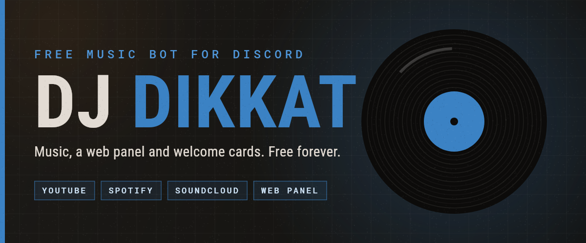
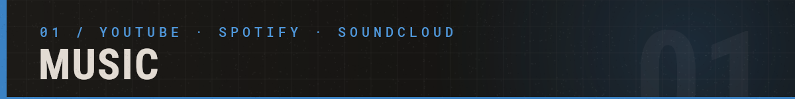
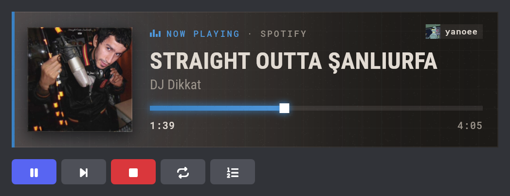
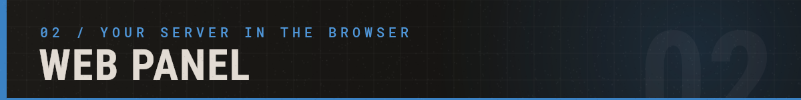
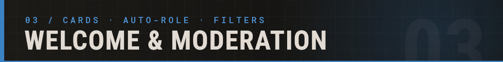
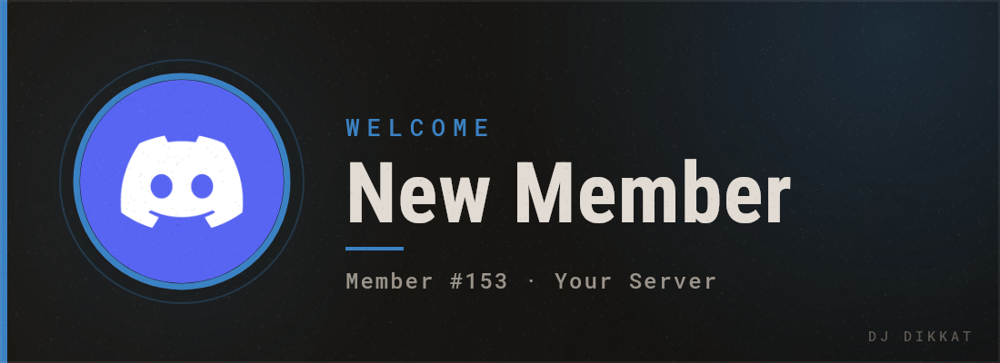
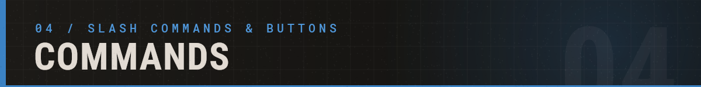
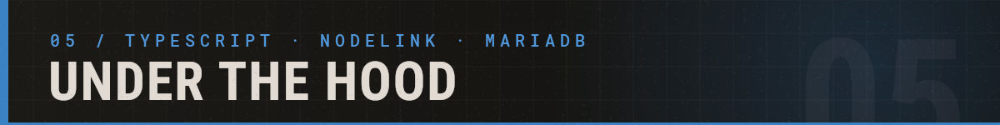
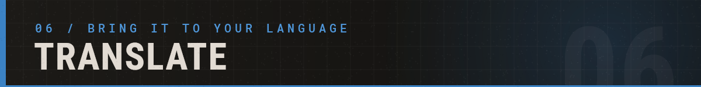
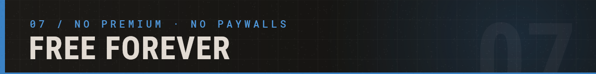

  

  
  
  
  
  

  
  
  
  

**DJ DIKKAT** is a free Discord music bot, made in memory of **DJ Dikkat (Mehmet Aykın)**, a rapper from Şanlıurfa. It plays YouTube, Spotify and SoundCloud, and comes with its own web panel, welcome cards and moderation tools.

No premium, no ads, no vote locks. Built by one person, free for everyone.

 

| | |
|:---:|---|
| 🎵 | **Every source.** Search by name with live suggestions, or paste a YouTube, Spotify or SoundCloud link: tracks, albums, playlists and Spotify artists. |
| 🎛️ | **One player card.** Artwork, a moving progress bar and one row of buttons. It reposts itself for every new song, so it never gets buried in chat. |
| 🔁 | **Loop and shuffle.** Loop one track or the whole queue, shuffle any time. |
| 📜 | **Queue of 25.** See what's next, reorder it, or jump straight to any song from the web panel. |
| 🔍 | **Smart search.** Finds the original, not the cover, remix or nightcore version, forgives typos and works without Turkish letters (`baris manco` finds *Barış Manço*). |
| 📊 | **History and stats.** Top tracks, top listeners and your server's busiest hours. |
| 🔌 | **Tidy.** Leaves when the channel empties or goes quiet for 5 minutes. |

 

Type `/panel` in your server and you get a private login link. Everything below runs in your browser at [djdikkat.com](https://www.djdikkat.com).

| | |
|:---:|---|
| ▶️ | **Player.** Search, queue, skip and seek while you listen in Discord. Drag songs to reorder, click one to play it now. |
| 💾 | **Playlists and history.** Save songs and play them again with one click. |
| 📈 | **Stats.** Plays per day and per hour, top tracks and top listeners with their avatars. |
| 🛡️ | **Permissions.** DJ roles, music channels, and who can use each command where. |
| 🎨 | **Settings.** The bot's language and your server's own player card colour. |

Only people with **Manage Server** can change settings, and the bot checks that again on every action.

 

| | |
|:---:|---|
| 🖼️ | **Welcome cards.** A picture card, a text message or both, posted in a channel and/or sent as a DM. Your colour, your background. |
| 🚪 | **Leave messages** when someone leaves. |
| 🏷️ | **Auto-role** for new members, after membership screening. |
| 🔗 | **Link blocker and word filter**, built on Discord's own AutoMod, so they keep working even if the bot is offline. |

 

| Command | What it does |
|---|---|
| `/play` | Play a song: a name (with live suggestions) or a YouTube / Spotify / SoundCloud link |
| `/pause` | Pause or resume |
| `/skip` | Skip the current track |
| `/stop` | Stop the music and clear the queue. The bot stays in voice |
| `/disconnect` | Make the bot leave the voice channel |
| `/queue` | Show the queue, 10 songs per page |
| `/history` | The newest 200 plays of your server, sent to your DMs |
| `/stats` | Music stats for your server |
| `/language` | English or Türkçe for this server |
| `/panel` | A one-time link to your server's web panel |
| `/health` | The bot's health report, sent to your DMs |

**The player card's buttons:** pause / resume, skip, stop, loop (off, one track, the whole queue) and the queue, which opens your private queue view with shuffle, clear and a link to the web panel.

 

- **Node.js 26** runs the TypeScript directly (type stripping, no build step). Strict types, no framework.
- **discord.js 14** with Discord's newer message layout for the player and setup cards.
- **NodeLink** streams the audio, driven through **Shoukaku 4**. Spotify links resolve through the Spotify Web API.
- **MariaDB** keeps history, stats and server settings, with nightly backups.
- **@napi-rs/canvas** draws the player, welcome and launch cards in the website's style.
- **djdikkat.com** is PHP 8.2 behind nginx and Cloudflare, with a small ops daemon for the owner's admin panel.

 

DJ DIKKAT speaks English and Turkish. Want it in your language? No coding needed: you translate two files, an automatic check catches anything missing, and you're credited on [djdikkat.com/translate](https://www.djdikkat.com/translate).

👉 **[Request a language](https://github.com/Yanoee/DJDikkat_MusicBot/issues/new?template=language-request.yml)** · **[Read the guide](TRANSLATING.md)**

 

DJ DIKKAT is free and stays free. Every server bill comes out of one hobby developer's pocket. If the bot saves you from paying for another one, you can help keep it running:

- ❤️ Support on **[Patreon](https://www.djdikkat.com/patreon)**. Nothing is ever required.
- ⬆️ Vote on **[Top.gg](https://www.djdikkat.com/vote)** so more servers find it.
- 🐛 Found a bug? **[Open an issue](https://github.com/Yanoee/DJDikkat_MusicBot/issues)**.

### 🖤 Dedication

This project is dedicated to **DJ Dikkat (Mehmet Aykın)**. It is not official and not affiliated, just a small personal tribute built with respect.

### License

[MIT](LICENSE): do what you want, just don't claim it's yours. Made by [@Yanoee](https://github.com/Yanoee).
