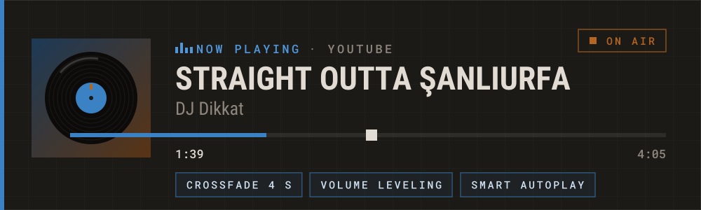
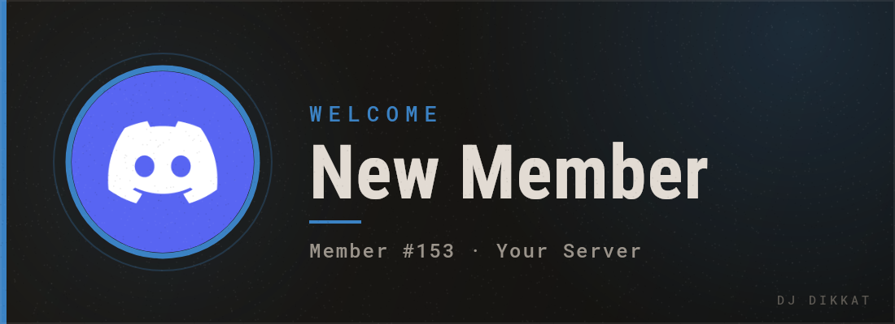

<p align="center">
  <a href="https://www.djdikkat.com">
    <picture>
      <source media="(prefers-color-scheme: dark)" srcset=".github/readme/hero-dark.svg">
      <source media="(prefers-color-scheme: light)" srcset=".github/readme/hero-light.svg">
      
    </picture>
  </a>
</p>

<p align="center">
  <a href="https://www.djdikkat.com/invite"></a>
  <a href="https://www.djdikkat.com"></a>
  <a href="https://www.djdikkat.com/dashboard"></a>
</p>

<p align="center">
  
  
  
  <a href="LICENSE"></a>
</p>

<p align="center">
  <a href="#whats-new">What's new</a> ·
  <a href="#features">Features</a> ·
  <a href="#commands">Commands</a> ·
  <a href="#languages">Languages</a> ·
  <a href="#under-the-hood">Under the hood</a> ·
  <a href="#contribute">Contribute</a> ·
  <a href="#free-forever">Free forever</a>
</p>

**DJ DIKKAT** is a free Discord music bot. Type `/play`, and it plays YouTube, Spotify and SoundCloud with smooth DJ transitions, a radio host and autoplay that stays on your vibe. It comes with its own web panel, welcome cards and moderation basics.

No premium. No ads. No vote locks. Built by one person, free for everyone.

<p align="center"></p>

<p>
  <a name="whats-new"></a>
  <picture>
    <source media="(prefers-color-scheme: dark)" srcset=".github/readme/01-whats-new-dark.svg">
    <source media="(prefers-color-scheme: light)" srcset=".github/readme/01-whats-new-light.svg">
    
  </picture>
</p>

<p align="center">
  <picture>
    <source media="(prefers-color-scheme: dark)" srcset=".github/readme/now-playing-dark.svg">
    <source media="(prefers-color-scheme: light)" srcset=".github/readme/now-playing-light.svg">
    
  </picture>
</p>

**v7.1: the music never stops.** Everything below is live, and all of it is free.

| | |
|:---:|---|
| ⏯️ | **Music through restarts.** Updates and restarts no longer stop the music. Every server picks up the same song, at the same second, with its queue intact. |
| 🎛️ | **DJ transitions.** Songs blend into each other with a crossfade of 0 to 12 seconds. Pause, skip and stop fade softly. Volume leveling keeps loud and quiet tracks even. On by default. |
| ♾️ | **Smart autoplay.** Stays close to what you play instead of drifting away. The card tells you why a song was picked: *Autoplay · like [song]*. Your songs always go first. |
| 📻 | **Radio host.** A radio-style voice between songs, in English or Turkish. It says what's next and who asked for it, shares real facts about the song and plays original jingles. Off by default. |
| 🔍 | **Sharper search.** Finds the original over covers, nightcore and sped-up versions. Handles more link types: YouTube app, embed and Shorts links, SoundCloud and Spotify short links. |
| 🖼️ | **Wider player card** with the song's cover blurred behind it, and a **redesigned web panel** with a server switcher, a mini player and a menu that works on phones. |

<br>

<p>
  <a name="features"></a>
  <picture>
    <source media="(prefers-color-scheme: dark)" srcset=".github/readme/02-features-dark.svg">
    <source media="(prefers-color-scheme: light)" srcset=".github/readme/02-features-light.svg">
    
  </picture>
</p>

### Playback

- **Every source.** Search by name with live suggestions, or paste a YouTube, Spotify or SoundCloud link: tracks, albums, playlists and Spotify artists.
- **One player card.** Artwork, a moving progress bar and one row of buttons. It reposts itself for each new song, so it never gets buried in chat.
- **Smart search.** Forgives typos and works without Turkish letters: `baris manco` finds *Barış Manço*. AI-dubbed YouTube videos play their original audio.
- **Loop and shuffle.** Loop one song or the whole queue. Shuffle any time.
- **Queue of 25.** See what's next, reorder it, or jump to any song from the web panel.
- **Sound effects.** Bass boost, nightcore, vaporwave, slowed + reverb, 8D, karaoke, soft, treble and echo.
- **Tidy.** Leaves after 5 quiet minutes or when the channel empties, and cleans up its card.

### DJ transitions

- **Crossfade** from 0 to 12 seconds. The default is 4.
- **Soft fades** on pause, resume, skip, stop and seek. No more hard cuts.
- **Volume leveling** plays every song at a similar volume.
- Set it with `/transitions` or in the web panel. Saved per server.

### Smart autoplay

- When the queue runs out, similar songs follow. Turn it on with `/autoplay`.
- It only learns from songs **people** asked for, never from its own picks, so it can't wander off.
- It checks YouTube's mixes first and makes sure each match really is that song.
- Skip an autoplay pick early, and it steers away from songs like it.

### Radio host

- A short radio-style line over the start of a song: what's next, and who asked for it.
- Written in English **and** in Turkish, not translated, so it sounds natural in both.
- **Real trivia** about every 10 songs, from real sources only (Spotify and Wikipedia).
- **Jingles:** our own original stingers, or your own YouTube or SoundCloud link.
- Choose how often it talks and how loud. Off until you turn it on with `/radio`.

### Playlists

- Server playlists with up to 200 songs and their own covers, made in the web panel.
- Import from YouTube, Spotify or SoundCloud.
- Play one with `/playlist play`, or add the song that's playing with `/playlist add` or the card's button.

### Web panel

Type `/panel` in your server and the bot DMs you a one-time login link. It works once and expires in 10 minutes.

- **Player:** search, queue, skip and seek while you listen in Discord. Drag to reorder, click a song to play it now.
- **Sound:** effects, autoplay, transitions and the radio host, side by side under the player.
- **Stats:** plays per day and per hour, top tracks and top listeners.
- **Settings:** the bot's language and your server's own player card colour.

Server admins (**Manage Server**) always get in, and the bot checks again on every action.

### Server tools

<p align="center"></p>

- **Welcome cards.** A picture card, a text message or both, in a channel and/or as a DM. Your colour, your background.
- **Leave messages** and **auto-role** for new members, after membership screening.
- **DJ role.** Everyone can play, pause and skip their own songs. The DJ role (and admins) can also stop, skip anyone's song, loop, shuffle, clear the queue and change the sound. Alone with the bot? Then you can do everything.
- **Permissions.** Music channels, voice channels and rules for every command. Admins can never be locked out.
- **Moderation basics.** A link blocker and a word filter built on Discord's own AutoMod, so they keep working even when the bot is offline.
- **History and stats.** Top tracks, top listeners and your server's busiest hours.

<br>

<p>
  <a name="commands"></a>
  <picture>
    <source media="(prefers-color-scheme: dark)" srcset=".github/readme/03-commands-dark.svg">
    <source media="(prefers-color-scheme: light)" srcset=".github/readme/03-commands-light.svg">
    
  </picture>
</p>

| Command | Options | What it does |
|---|---|---|
| `/play` | `query` | Play a song by name (with live suggestions) or a YouTube / Spotify / SoundCloud link |
| `/playlist play` | `name`, `shuffle` | Queue one of this server's playlists, in order or shuffled |
| `/playlist add` | `name` | Add the song that's playing to a playlist |
| `/pause` | | Pause or resume |
| `/skip` | | Skip the current song |
| `/queue` | | Show the queue, with who asked for each song |
| `/filter` | `effect` | A sound effect: bass boost, nightcore, vaporwave, slowed + reverb, 8D, karaoke, soft, treble, echo. *Off* clears it |
| `/autoplay` | `on` | Keep playing similar songs when the queue runs out. Leave it empty to switch |
| `/transitions` | `on`, `crossfade` (0–12 s), `volume-leveling` | DJ transitions. No options shows the current settings |
| `/radio` | `on`, `every`, `trivia`, `names`, `volume`, `jingles`, `jingle`, `test` | The radio host. `every`: every song, every 3, every 5 or the first song only. `jingle`: your own link, or `default`. `test`: hear a sample line now |
| `/stop` | | Stop the music and clear the queue. The bot stays in voice |
| `/disconnect` | | Stop everything and leave the voice channel |
| `/history` | | The server's recent plays, sent to your DMs |
| `/stats` | | Top tracks and listeners for this server |
| `/language` | `language` | Auto, English or Türkçe for the server's public messages. Needs **Manage Server** |
| `/panel` | | A one-time login link to this server's web panel. Needs **Manage Server** or panel access |
| `/health` | | The bot's health report, sent to your DMs. Needs **Administrator** |

**The player card's buttons:** pause / resume, skip, stop, loop (off, one song, the whole queue) and the queue view, with shuffle, clear, *Add to playlist* and a link to the web panel.

<br>

<p>
  <a name="languages"></a>
  <picture>
    <source media="(prefers-color-scheme: dark)" srcset=".github/readme/04-languages-dark.svg">
    <source media="(prefers-color-scheme: light)" srcset=".github/readme/04-languages-light.svg">
    
  </picture>
</p>

DJ DIKKAT speaks **English** and **Türkçe**. Replies follow each user's Discord language, and `/language` sets the server's default for public messages.

Want it in your language? No coding needed. You translate two files, an automatic check catches anything missing, and you're credited on [djdikkat.com/translate](https://www.djdikkat.com/translate).

👉 **[Request a language](https://github.com/Yanoee/DJDikkat_MusicBot/issues/new?template=language-request.yml)** · **[Read the guide](TRANSLATING.md)**

<br>

<p>
  <a name="under-the-hood"></a>
  <picture>
    <source media="(prefers-color-scheme: dark)" srcset=".github/readme/05-self-hosting-dark.svg">
    <source media="(prefers-color-scheme: light)" srcset=".github/readme/05-self-hosting-light.svg">
    
  </picture>
</p>

This repository is the bot itself, in [`djdikkat/`](djdikkat).

### Tech stack

- **Node.js 24+** runs the TypeScript directly (type stripping, no build step). Strict types, no framework.
- **discord.js 14** with Discord's newer message layout for the player and setup cards.
- **NodeLink** streams the audio (Lavalink v4 API), driven through **Shoukaku 4**. Crossfade, fades, volume leveling and the radio host's voice layer are NodeLink features.
- **Spotify Web API** resolves Spotify links. Radio trivia comes from Spotify and Wikipedia, and the host's voice from Flowery TTS.
- **MariaDB** (through `mysql2`) keeps history, stats, playlists and server settings.
- **@napi-rs/canvas** draws the player and welcome cards in the website's style.

| Folder | What's in it |
|---|---|
| `src/commands` | The slash commands |
| `src/components`, `src/events` | Buttons, menus and Discord events |
| `src/music` | Player, search, Spotify, autoplay, transitions, radio host, restart resume |
| `src/services` | Database, settings, permissions, playlists, welcome cards, AutoMod |
| `src/ui` | The cards: player, queue, stats, health, setup, welcome |
| `src/i18n` | English and Turkish texts |
| `src/internal` | The bot's private API for the website (localhost only, behind secrets) |
| `tests` | `npm test`: search, autoplay, transitions, radio lines, texts and card rendering |

### Self-hosting

The easiest way to use DJ DIKKAT is to **[add it to your server](https://www.djdikkat.com/invite)**. It's free.

The code is open to read, learn from and run. It's not a one-click install, though: the website, the web panel and the database schema live outside this repo. To run the bot yourself you need:

1. **Node.js 24** or newer.
2. A **NodeLink** node. The bot talks the Lavalink v4 API, but it's built for NodeLink: transitions, the radio host, jingles and some effects only work there.
3. A **MariaDB** database.
4. A Discord bot token, and optionally a Spotify app for Spotify links.

```bash
cd djdikkat
npm ci
npm test
npm start   # loads ../shared/.env if it exists
```

<details>
<summary><b>Environment variables</b> (names only, read in <code>src/config.ts</code>)</summary>
<br>

| Required | What it's for |
|---|---|
| `BOT_DISCORD_TOKEN` | The Discord bot token |
| `BOT_NODELINK_HOST`, `BOT_NODELINK_PORT`, `BOT_NODELINK_PASS` | Your NodeLink node |
| `BOT_DB_USER`, `BOT_DB_PASS` | The MariaDB login |
| `COMMON_PUBLIC_URL` | Your website's address, used in links |
| `COMMON_PATREON_URL`, `COMMON_GITHUB_URL`, `COMMON_TOPGG_URL` | Links shown by the bot |
| `OPS_BOT_ADMIN_SECRET` | Secret for the bot's private admin API |

| Optional | What it's for |
|---|---|
| `BOT_DEPLOY_COMMANDS` | `true` registers the slash commands on start |
| `BOT_SPOTIFY_ID`, `BOT_SPOTIFY_SECRET` | Spotify links and trivia |
| `BOT_NODELINK_SECURE` | `true` for a TLS NodeLink connection |
| `BOT_OWNER_IDS`, `BOT_TEST_GUILD_ID` | Who can use the bot during maintenance |
| `COMMON_DB_HOST`, `COMMON_DB_PORT`, `COMMON_DB_NAME` | Database address (defaults: local, 3306, `djdikkat`) |
| `COMMON_BOT_INTERNAL_PORT`, `WEB_BOT_PANEL_SECRET` | The private API for a web panel |
| `COMMON_APPS_DIR`, `COMMON_LOG_DIR` | Where the schema and logs live |

The bot refuses to start and lists what's missing if a required one is empty.

</details>

<br>

<p>
  <a name="contribute"></a>
  <picture>
    <source media="(prefers-color-scheme: dark)" srcset=".github/readme/06-contributing-dark.svg">
    <source media="(prefers-color-scheme: light)" srcset=".github/readme/06-contributing-light.svg">
    
  </picture>
</p>

- 🌍 **Translate.** The quickest way to help. Start with the [translation guide](TRANSLATING.md).
- 🐛 **Report a bug or share an idea.** [Open an issue](https://github.com/Yanoee/DJDikkat_MusicBot/issues). Say what you did, what you expected and what happened.
- 🛠️ **Send code.** Keep pull requests small and focused, run `npm run typecheck` and `npm test` first, and keep user-facing text in `src/i18n` so it can be translated.

<br>

<p>
  <a name="free-forever"></a>
  <picture>
    <source media="(prefers-color-scheme: dark)" srcset=".github/readme/07-support-dark.svg">
    <source media="(prefers-color-scheme: light)" srcset=".github/readme/07-support-light.svg">
    
  </picture>
</p>

DJ DIKKAT is free and stays free. There is no premium tier, and there never will be. Every server bill comes out of one hobby developer's pocket. If the bot saves you from paying for another one, you can help keep it running:

<p>
  <a href="https://www.djdikkat.com/patreon"></a>
  <a href="https://www.djdikkat.com/vote"></a>
</p>

- ❤️ **[Patreon](https://www.djdikkat.com/patreon)**: nothing is ever required, and nothing is locked.
- ⬆️ **[Vote on Top.gg](https://www.djdikkat.com/vote)** so more servers find it, or leave a review.
- ⭐ **Star this repo.** It helps more than you think.

### 🖤 Dedication

DJ DIKKAT is made in memory of **DJ Dikkat (Mehmet Aykın)**, a rapper from Şanlıurfa. It is not official and not affiliated, just a small personal tribute built with respect.

### License

[MIT](LICENSE): do what you want, just don't claim it's yours. Made by [@Yanoee](https://github.com/Yanoee).

<p align="center"></p>
